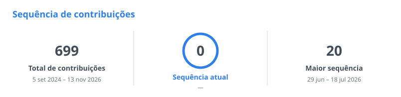

## Sobre mim

- Estudante de Engenharia de Software
- Product Owner na TBDC Agro Software
- Cuiabá - MT, Brasil

 

<b>Tecnologias</b>

 

  <table>
    <tr>
      <td valign="top" width="50%">
        <b>Linguagens e Banco de Dados</b>
          
        
      </td>
      <td valign="top" width="50%">
        <b>Ferramentas e Plataformas</b>
          
        
      </td>
    </tr>
  </table>

<b>Estatísticas</b>

 

  <picture>
    <source media="(prefers-color-scheme: dark)" srcset="./profile/stats-dark.svg" />
    
  </picture>
  <picture>
    <source media="(prefers-color-scheme: dark)" srcset="./profile/top-langs-dark.svg" />
    
  </picture>

 

  <picture>
    <source media="(prefers-color-scheme: dark)" srcset="./profile/streak-dark.svg" />
    
  </picture>

<b>Contribuições</b>

 

  <picture>
    <source media="(prefers-color-scheme: dark)" srcset="https://raw.githubusercontent.com/JoaoFaccio087/JoaoFaccio087/output/pacman-contribution-graph-dark.svg" />
    <source media="(prefers-color-scheme: light)" srcset="https://raw.githubusercontent.com/JoaoFaccio087/JoaoFaccio087/output/pacman-contribution-graph.svg" />
    
  </picture>

 

  
  &nbsp;
  

